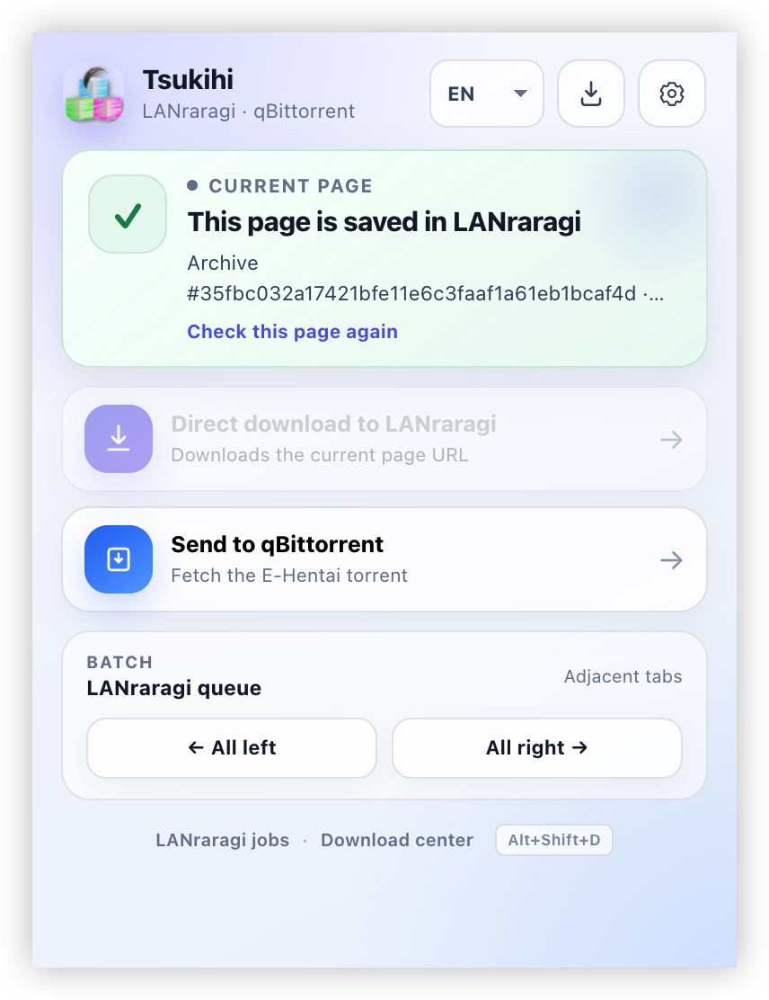

# Tsukihi

Tiny WebBrowser helper for . 🐦

Tsukihi provides separate workflows for direct LANraragi downloads and E-Hentai torrent downloads through qBittorrent. Every task can be followed from one dedicated download center.

## Features

- [x] Checks your LANraragi server to see whether the current URL has already been downloaded
- [x] Provides separate buttons for direct LANraragi downloads and E-Hentai qBittorrent downloads
- [x] Sends ordinary URLs directly to LANraragi without silently falling back to another download engine
- [x] Parses current E-Hentai / ExHentai torrents and sends them directly to qBittorrent
- [x] Supports qBittorrent API Keys with `Authorization: Bearer qbt_...` and automatically retries with `X-API-Key` for compatible versions
- [x] Never calls `/api/v2/auth/login` when an API Key is configured; traditional username/password login remains available for older versions
- [x] Confirms whether qBittorrent actually acquired the torrent before treating the request as successful
- [x] Supports both the newer qBittorrent JSON add response and the legacy `Ok.` / `Fails.` response
- [x] Tracks overall and per-file download progress, speed, ETA, peers, and qBittorrent state
- [x] Includes a dedicated download center for active, completed, and failed tasks
- [x] Provides page and link context-menu actions for LANraragi and E-Hentai qBittorrent downloads
- [x] Shows a launch animation while a download is being prepared
- [x] Supports English and Chinese across the popup, settings page, download center, context menus, and notifications
- [x] Defaults to English
- [x] Supports the following keyboard shortcuts:
  - `Alt+Shift+D`: Download the current page to LANraragi
  - `Alt+Shift+Q`: Send the current E-Hentai page to qBittorrent
  - `Alt+Shift+P`: Open the Tsukihi download center
- [x] Allows downloaded URLs to be added to a LANraragi category for read-later workflows

## Required LRR Server Version

- Basic URL Downloading: From **v0.7.3** - _"Glass Spider"_ onwards.
- Full support: From **v0.7.8** - _"Looking for Lester"_ onwards.

## Installation on Chrome and derivatives

1. Clone or download this repo.
2. Open the [Extensions page](chrome://extensions/) in your browser and enable developer mode.
3. Click **Load unpacked** and select the Tsukihi directory.
4. Complete the setup below.

To update, pull or redownload the repository, then reload the extension from the browser's Extensions page. Reload tabs that were opened before the update so the extension can run correctly on those pages.

Chrome may warn you about using an unpacked extension that was not installed from the Chrome Web Store.

## Installation on Firefox (signed XPI)

0. Download the latest signed `.xpi` file from the [Releases](https://github.com/Difegue/Tsukihi/releases) page.
1. Open the extensions page in Firefox and choose **Install Add-on From File...** from the gear menu.
2. Complete the setup below.

## Installation on Firefox (running from Git source)

0. A nightly, developer, or unbranded edition of Firefox is required because regular Firefox builds cannot install unsigned add-ons. See the [unbranded builds documentation](https://wiki.mozilla.org/Add-ons/Extension_Signing#Unbranded_Builds).
1. Clone this repo.
2. Zip the contents of the Tsukihi directory, but not the directory itself, and change the archive extension to `.xpi`.
3. Set `xpinstall.signatures.required` to `false` in Firefox `about:config`.
4. Open the extensions page and load the `.xpi` file.
5. Complete the setup below.

## LANraragi setup

1. Open your LANraragi server settings and create an API Key.
2. Enable **CORS for the Client API**.
3. Open Tsukihi's settings page.
4. Enter the LANraragi server URL, including the scheme, and its API Key.
5. Click **Check connection** and confirm that the server, download plugins, and categories are loaded.
6. Optionally choose a category for downloaded URLs.
7. Save the settings.

## qBittorrent setup

1. Open the qBittorrent WebUI and create or rotate an API Key in its settings. New keys normally start with `qbt_`.
2. Open Tsukihi's settings page and enter the qBittorrent WebUI URL.
3. Paste the API Key and click **Test qBittorrent**.
4. Optionally set a download save path, then save the settings.

API Key authentication does not call `/api/v2/auth/login`. If your qBittorrent version does not support API Keys, leave the API Key empty and use the traditional username/password fields instead.

## Usage

- Open the extension popup and choose **Direct download to LANraragi** or **Send to qBittorrent**.
- Right-click a page or link to use the corresponding download action.
- Use the keyboard shortcuts above to download the active tab or open the download center.
- Open the **Download center** to follow seed acquisition, overall download progress, and per-file progress.
- Use the language selector in the popup, settings page, or download center to switch between **English** and **Chinese**.
